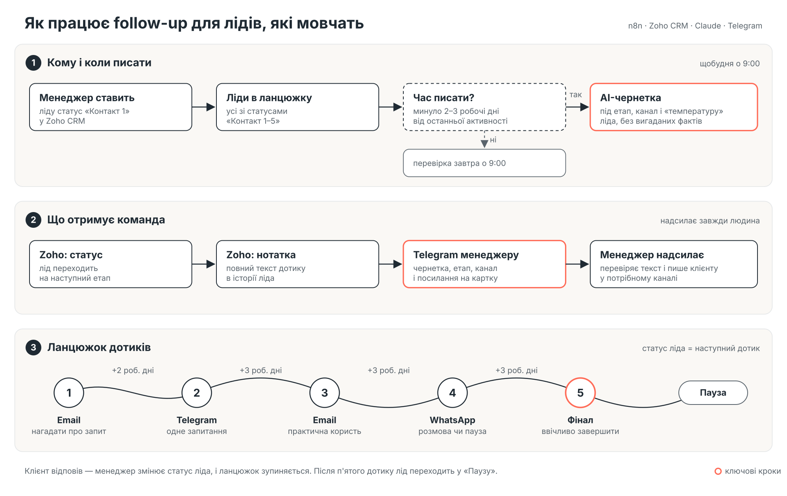

# Silent Lead Follow-up · n8n

**5-touch cadence for leads who stopped replying: AI drafts each touch, the CRM moves the lead forward and the manager gets the draft in Telegram.**

Demo project by Procesto, tested end to end on a test lead in Zoho CRM.

## The problem

Leads who go silent after the first contact are rarely lost because of price. More often nobody wrote to them again, or every follow-up said the same "just checking in". Keeping track of who is due for which message, on which channel, is manual work that slips first when the team is busy.

## What the workflow does

1. **Every weekday at 9:00** it searches Zoho CRM for leads whose *Lead Status* is one of the five cadence stages.
2. **It picks only the leads that are due.** Each stage has a minimum number of business days since the last activity:

   | Stage | Channel | Waits | Next status |
   | --- | --- | --- | --- |
   | 1 | Email | 0 days | Stage 2 |
   | 2 | Telegram | 2 days | Stage 3 |
   | 3 | Email | 3 days | Stage 4 |
   | 4 | WhatsApp | 3 days | Stage 5 |
   | 5 | Email (closing) | 3 days | Pause |

3. **Claude drafts the message.** It uses the lead's request, BANT notes, temperature (Hot / Warm / Cold from the AI score) and the stage strategy. The prompt forbids invented facts, numbers, discounts and fake urgency.
4. **Zoho is updated:** the lead moves to the next status, and `AI_next_action` says what to send.
5. **The draft is saved as a Note on the lead,** so the history stays in the CRM.
6. **The manager gets the draft in Telegram** with a link to the lead. The manager reviews it and sends it personally; nothing goes to the client automatically.

When the client replies, the manager changes the status and the cadence stops for that lead.

## Stack

n8n (self-hosted) · Zoho CRM API v2 · Anthropic Claude · Telegram Bot API

## Setup

1. Import `workflows/silent-lead-follow-up.json` into n8n.
2. In Zoho CRM, add these values to the *Lead Status* picklist:
   - `Контакт 1 · email`
   - `Контакт 2 · Telegram`
   - `Контакт 3 · email`
   - `Контакт 4 · WhatsApp`
   - `Контакт 5 · фінал`
   - `Пауза`

   To use other names, change the same values in `STAGES` (node **Pick leads due for a touch**) and in the search `criteria` (node **Zoho: leads in cadence**).
3. Optional custom fields on Leads:
   - `score_AI` (number) and `bant_qulif` (text). If they are empty, the lead is treated as Warm. Both are filled by a separate lead-qualification workflow.
   - `AI_next_action` (text, 255).
4. Connect credentials: Zoho OAuth2, Anthropic and Telegram.
5. Replace the placeholders from [`.env.example`](.env.example).
6. Run it once manually with a test lead, then activate it.

The prompts and the Telegram message are in Ukrainian, because the cadence was written for Ukrainian-speaking clients. To use another language, change the system message in **AI: draft touch** and the text in **Telegram: draft to manager**.

## Notes

- Draft first, human sends: the workflow never messages a client directly.
- Business days are counted Monday to Friday; public holidays are not excluded.
- Zoho search indexing can lag about a minute after a status change, so a freshly edited lead may be picked up on the next run.
- No client data is included in this repository.

## License

MIT, see [LICENSE](LICENSE). Use and adapt the workflows freely.

## Want this for your team?

Procesto designs and runs automations like this for small and mid-sized businesses in the EU.
→ [Fill in a short brief](https://tally.so/r/J1lLxK?utm_source=github&utm_medium=repo&utm_campaign=portfolio&utm_content=silent-lead-follow-up) · [procesto.eu](https://procesto.eu)
